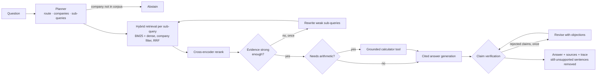

# FinDocGPT

An agentic RAG system that answers analyst questions about SEC 10-K filings with cited, verified answers. It covers the
latest 10-K of ten large-cap companies (Apple, Amazon, Alphabet, Meta, Netflix, Microsoft, NVIDIA, Salesforce, Adobe, Uber).

```
Q: Calculate Google Cloud's operating-margin change between the two latest annual periods.
A: Google Cloud's operating margin rose from 14.14% in fiscal 2024 to 23.69% in fiscal 2025, a change of 9.56%
   percentage points[S1].

S1 = calculator: (a / b - c / d) * 100 with a = 13,910 and c = 6,112 (segment operating income table) and
     b = 58,705 and d = 43,229 (revenue by type table); each operand was checked to appear verbatim in its source.
```
(Actual output of the current agent, copied verbatim.)

## Results

Measured on a hand-verified gold set of 45 questions (details under [Evaluation](#evaluation)). The baseline is the
project's original single-pass pipeline; its predictions were frozen before the rewrite and scored with the same harness (`v1` in the result files).

| | Baseline | **FinDocGPT** |
|---|---|---|
| Answer correctness (independent LLM judge vs. gold key facts) | 0.17 | **0.55** |
| Key-fact coverage | 0.28 | **0.75** |
| Faithfulness (answer sentences supported by retrieved context) | 0.78 | **0.97** |
| Numeric accuracy on computation questions (exact value) | 0.20 | **1.00** |
| Gold evidence recall in the generator's context | 0.15 | **0.80** |
| Route accuracy | 0.65 | **1.00** |
| False abstention on answerable questions (lower is better) | 0.15 | **0.03** |
| Abstains on unanswerable questions | 0.60 | **1.00** |

By category, correctness is 0.90 on computation, 0.60 on comparison and 0.35 on factual questions. Factual answers most
often name the driver but omit a figure the gold expects. Full tables: [eval/results/REPORT.md](eval/results/REPORT.md)
and [RETRIEVAL_ABLATION.md](eval/results/RETRIEVAL_ABLATION.md).

## How it works



The agent is a [LangGraph](src/agent/graph.py) state machine:

| Step | What it does | Why |
|---|---|---|
| **Ingestion** ([parser](src/ingestion/parser.py), [tables](src/ingestion/tables.py)) | Splits each 10-K into ~300-token prose chunks *within* an Item section, and rebuilds every financial table from its HTML cells (colspans, split `$`/`%`/`)` cells, units rows, two-level year headers). Each chunk gets a contextual header: company, fiscal year, Item, subsection. | Filing sentences rarely name the company ("Services net sales increased…"), so without the header, ten filers' MD&A text looks the same. The baseline indexed 6,700 HTML fragments with a median of 66 tokens. |
| **Planner** ([planner.py](src/agent/planner.py)) | An LLM picks the route (factual / comparison / computation) and the companies, and splits comparisons into one sub-query per entity, flagging which ones live in tables. Tickers are cross-checked by deterministic name matching, and a rule-based planner is the fallback. | The baseline's regex router sent "drivers of Services *net sales*" to the numeric agent because the question mentions a metric. |
| **Retrieval** ([store.py](src/retrieval/store.py)) | BM25 and `bge-base-en-v1.5` dense search in Qdrant (embedded on disk, or a server via `QDRANT_URL`), both filtered by company, fused with reciprocal-rank fusion, then reranked with `bge-reranker-base`. | RRF avoids mixing incompatible score scales; filters stop ten filers' boilerplate from competing. |
| **Corrective loop** | If a sub-query's best rerank score is below 0.2, the LLM rewrites it in 10-K vocabulary and retrieval runs once more. The better attempt is kept. | A cheap self-correction step that only triggers on weak evidence. |
| **Calculator** ([calculator.py](src/agent/calculator.py)) | The LLM picks operands (each with exact cell text and source chunk) and an arithmetic expression. Each operand must appear verbatim in its cited chunk, the expression is evaluated with a safe AST evaluator, and if validation fails the error is fed back for one retry. | The LLM never does arithmetic, and every number traces to a table cell. The baseline parsed table rows with regexes and produced values like "39000966.0%". |
| **Generation + verification** ([answer.py](src/agent/answer.py)) | `gpt-oss-120b` answers only from numbered sources with per-sentence citations and never does arithmetic itself. A second model checks every sentence against the sources. Rejected sentences go back to the writer with the checker's reasons for one revision, and whatever is still unsupported is removed. | Faithfulness is enforced at runtime, not just measured offline. The revision step avoids throwing away answers that only had a wrong citation or one overreaching clause. |

Every LLM call goes through [llm.py](src/llm.py): Groq's OpenAI-compatible API, JSON mode, rate-limit backoff, and a
content-addressed disk cache (re-running the eval only pays for steps whose inputs changed).

## Evaluation

**Gold set** ([eval/gold_set.json](eval/gold_set.json)): 40 answerable questions (20 factual, 10 comparison,
10 computation, at least 3 per company) plus 5 unanswerable ones (a company outside the corpus, a year the filing doesn't
cover, a forecast the filing doesn't make, data only in the proxy statement). Each answerable item has:

- a reference answer written from the filing text, not generated by the pipeline (the baseline's references were produced by
  the same retriever and LLM being evaluated, so the system was graded against itself);
- 2–4 atomic **key facts** used for correctness scoring;
- **verbatim evidence strings** copied from the filing. Retrieval is scored by whether the evidence reaches the
  generator's context, independent of chunk IDs. Table rows match on label plus all numbers, so systems that render
  tables differently are scored fairly;
- for computation items, an **expected value** computed by hand from the filing tables (e.g. Google Cloud margin
  change = 13,910/58,705 − 6,112/43,229 = +9.56 pp).

**Metrics** ([eval/metrics.py](eval/metrics.py)): deterministic where possible (route accuracy, evidence recall, numeric
accuracy within max(0.15, 2%), abstention). An LLM judge (`qwen3.8-27b`, a different model family from the generator,
blind to which system produced the answer) scores key-fact coverage, contradictions with the gold answer, and
sentence-level faithfulness to the context the system retrieved.

**Retrieval ablation** (no LLM, same 40 questions; recall of gold evidence in the top 8 chunks):

| Configuration | recall@8 | MRR |
|---|---|---|
| Baseline pipeline (6.7K HTML-fragment chunks, bge-small) | 0.15 | 0.10 |
| BM25 only | 0.44 | 0.20 |
| Dense only (bge-base) | 0.59 | 0.30 |
| Hybrid RRF | 0.55 | 0.25 |
| Hybrid + cross-encoder rerank | 0.72 | 0.42 |
| Hybrid + rerank + company filter | 0.65 | 0.41 |
| Full agent context (planner sub-queries, decomposition, rewrites) | **0.80** | **0.44** |

Most of the retrieval gain comes from the new corpus (section-aware chunks with contextual headers and normalized
tables) and the reranker. RRF on its own scores slightly below dense-only at this depth. A hard company filter
slightly *hurts* single-query recall, because the contextual headers already identify the company and the filter
shrinks the candidate pool for comparison questions. The agent's per-entity sub-queries and rewrites add 8 points on top.

**Error analysis of an earlier run** drove the last changes. Computation answers gave the delta without the per-year values. One
calculation used the wrong pair of years. The verifier deleted correct sentences that had the wrong citation, wiping
out three answers. And single-query retrieval missed MD&A "primarily due to" passages. The fixes were a revise step
before removal, verification against all sources, intermediate values and a period hint in the calculator, and an MD&A
sub-query hint in the planner.

**Remaining errors in the final run.** One answer called a rise in NVIDIA inventory provisions "down", and the LLM
verifier did not catch the direction word. A deterministic check now overrides the verifier for "rose/fell from A to B" and
"B (down from A)" statements whose figures contradict the word; over all 259 answer sentences from every evaluation run it flags
only that sentence. One Uber profitability question was a retrieval miss: the gold evidence never reached
the context. The planner replaced the question with a single generic MD&A-style sub-query ("operating income increased
compared to prior year primarily due to"), which matched other passages well enough (rerank 0.52) that no rewrite
triggered, and the agent, correctly given its context, abstained. Always keeping the original question as a sub-query
is the obvious next fix.
Factual answers sometimes give the driver without the figure the gold expects. The judge itself once returned a
misspelled JSON key (`key_fats`); scoring now locates verdict lists by content and treats malformed verdicts as missing,
never as zero.

**Tried and reverted: table notes**. Manual testing found a "right number, wrong
meaning" error: asked about Apple's and NVIDIA's Item 5, the agent called the value of $100 invested five years earlier
a "stock price", because the paragraph explaining the table was a separate chunk. The experiment attached the prose
preceding each table as a `Note:` line and told the writer and verifier to check that each figure is described as its
source defines it. It fixed that case, but correctness fell 0.55 → 0.50 on the gold set. Tables without a real
introduction picked up unrelated MD&A text, and with it the calculator swapped Amazon's year columns. The stricter
verifier also rejected a partly correct answer, so the change was reverted. A narrower version (attach only paragraphs
that introduce the table, such as "The following graph…") is the next thing to try.

**Limitations.** 45 questions is a small set, and the gold answers were written by one annotator. Prompts were refined
after looking at failures on this same set, with no separate held-out split, so these numbers are optimistic for
unseen questions. The LLM judge is imperfect, and some "incorrect" answers are partially right. The corpus is one
10-K per company, so cross-year questions beyond what a single filing reports can't be answered.

## Running it

Requires Python 3.11 and a free [Groq](https://console.groq.com) API key.

```bash
pip install -r requirements.txt
cp .env.example .env                       # add GROQ_API_KEY and SEC_USER_AGENT

python -m src.ingestion.run_ingestion      # download the pinned 10-Ks from EDGAR and build data/corpus/chunks.jsonl
python -m src.retrieval.build_index        # embed into Qdrant (embedded at data/index/; ~20 min on CPU, incremental after)
python -m src.ingestion.export_readable    # optional: data/readable/<TICKER>.md, the corpus as the agent sees it
python -m pytest -q                        # offline tests: no network or models needed

uvicorn backend.main:app --port 8000       # API: POST /api/chat {"query": "..."}
cd frontend && npm install && npm run dev  # UI at http://localhost:5173
```

Or, after building the corpus and index once: `docker compose up --build`.

Reproduce the evaluation:

```bash
python -m eval.run_eval --system v1        # re-score the frozen baseline predictions
python -m eval.run_eval                    # run + score the agent, write eval/results/REPORT.md
python -m eval.run_eval --config no_verify # ablation: skip claim verification (reuses cached generations)
python -m eval.retrieval_ablation          # retrieval-only ablation, no LLM calls
```

## Layout

```
src/
  ingestion/   EDGAR client, section-aware parser, HTML table normalizer
  retrieval/   hybrid BM25 + Qdrant search, reranker, RRF, index builder
  agent/       planner, calculator tool, answer writer + verifier, LangGraph workflow
  llm.py       Groq client (JSON mode, backoff, cache);  config.py, companies.py
backend/       FastAPI app
frontend/      React + Vite UI (answer, calculator, removed claims, agent trace, sources)
eval/          gold set, metrics, runners, results/ (predictions, scores, reports)
tests/         offline unit and graph tests with fake LLMs and retriever
```
