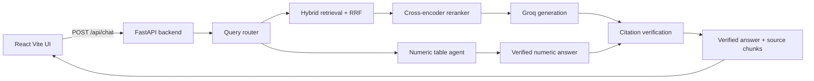

# FinDocGPT

An agentic RAG system for analyst-style questions over SEC filings. Development is checkpointed by phase; the current implementation now reaches Phase 7 with a FastAPI backend, React frontend, and Docker-compose local deployment.

## Phase 1 quick start

1. Create and activate the requested Python 3.11 conda environment, `findocgpt`.
2. Install dependencies: `pip install -r requirements.txt`
3. Copy `.env.example` to `.env`, then replace `SEC_USER_AGENT` with an identifying application name and contact email.
4. Run a small smoke ingestion:

```powershell
python -m src.ingestion.run_ingestion --tickers AAPL --filing-types 10-K --filings-per-type 1
```

The command saves original filing HTML under `data/raw_filings/`, prose chunks in `data/processed/prose_chunks.jsonl`, and each structured financial table as a Parquet file with a manifest in `data/processed/tables/`.

`GROQ_API_KEY` is the only LLM credential planned for the project. Phase 6 configures RAGAS explicitly with Groq's OpenAI-compatible endpoint, never an OpenAI key.

## Phase 2 quick start

Phase 2 indexes the Phase 1 **prose** corpus two ways: BM25 remains in-process and Qdrant stores normalized `BAAI/bge-small-en-v1.5` embeddings. At query time the two rankings are combined by reciprocal-rank fusion (RRF), rather than combining their incompatible numeric scores.

```powershell
docker compose up -d qdrant
python -m src.retrieval.index --recreate
python -m src.retrieval.query "What drove Apple's gross margin?" --k 5
```

The first index command downloads the embedding model and may take a few minutes on CPU. Qdrant data persists in the named Docker volume. Tables are intentionally not sent through this prose retrieval index; Phase 4's numeric agent will read their structured Parquet data.

## Phase 3 quick start

Phase 3 sends only the top 20 hybrid candidates to `BAAI/bge-reranker-base`, a cross-encoder that scores the query and each chunk together. It returns the strongest five and prints their original fused ranks so the order change is inspectable.

```powershell
python -m src.reranking.compare "What drove Apple's gross margin?" --candidate-limit 20 --k 5
```

The first run downloads the reranker checkpoint; it runs on CPU. This reranker is deliberately a second-stage precision step, not a replacement for hybrid retrieval.

## Phase 4 quick start

The hand-rolled router chooses one explicit path: `factual_lookup` and `comparison` use hybrid retrieval followed by cross-encoder reranking; `computation` bypasses prose generation and uses pandas to calculate from the separately stored Phase 1 Parquet tables.

```powershell
python -m src.router.examples
```

The computation example should report Apple's total gross margin percentage as 46.2% in 2024 and 46.9% in 2025, a +0.7 percentage-point change, along with its source table ID and arithmetic.

## Phase 5 quick start

Before an answer is returned, each sentence-level claim is verified against the retrieved source chunks. Production verification uses `GROQ_API_KEY` and `GROQ_JUDGE_MODEL` through Groq's OpenAI-compatible endpoint. Unsupported claims are **dropped**; supported claims receive explicit chunk IDs.

```powershell
python -m pytest -q tests/test_citations.py
python -m src.verification.demo
```

The test uses a conservative local entailment check and proves that an adversarial, unsupported `$500 billion` revenue claim is removed. The demo uses the configured Groq judge and requires a real `GROQ_API_KEY`.

## Phase 6 quick start

Phase 6 runs the quantitative evaluation harness over the reviewed 40-item test set. It routes each item through the actual pipeline, scores the outputs with RAGAS, and writes raw plus summarized results into `eval/results/`.

```powershell
conda run -n findocgpt python -m eval.run_eval
```

If your local `.env` still points at a retired Groq judge model, the code falls back to a supported replacement automatically.

## Phase 7 quick start

Phase 7 wraps the working pipeline in a FastAPI endpoint and a React chat UI. The backend returns verified answers plus expandable source chunks; the frontend uses a Vite proxy so `/api/chat` reaches the backend cleanly in local dev and Docker.

```powershell
docker compose up --build
```

Open the app at `http://localhost:5173` and the API at `http://localhost:8000/health`. The UI shows the route taken, the verified answer, any removed unsupported claims, and each retrieved source chunk in expandable cards.


